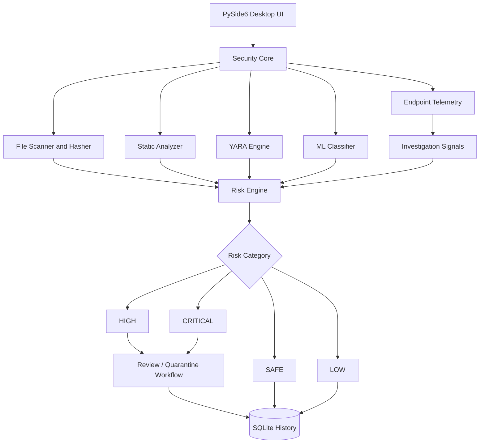

<div align="center">

# 🛡️ SentinelX
### AI-Powered Local Malware & Intrusion Detection for Windows

**A local-first defensive security desktop application that analyzes suspicious files, explains risk signals, monitors endpoint activity, and isolates potential threats.**

<p>
  <a href="https://github.com/sunil-offx/Sentinel_SecurityX/stargazers">
    
  </a>
  <a href="https://github.com/sunil-offx/Sentinel_SecurityX/network/members">
    
  </a>
  <a href="https://github.com/sunil-offx/Sentinel_SecurityX/blob/main/LICENSE">
    
  </a>
  
  
</p>

**[Explore the Code](https://github.com/sunil-offx/Sentinel_SecurityX) · [Report a Bug](https://github.com/sunil-offx/Sentinel_SecurityX/issues) · [View the Risk Register](RISK_REGISTER.md)**

</div>

---

## 👋 Project at a Glance

SentinelX is a **Windows endpoint-security project** built to demonstrate how multiple defensive signals can be combined into a practical malware-triage workflow. It brings file scanning, static analysis, YARA matching, machine-learning classification, endpoint telemetry, risk scoring, and quarantine management into a desktop interface.

Instead of relying on a single detection signal, SentinelX combines indicators and provides readable reasons that help a user investigate why a file or activity may be suspicious.

> **Security scope:** SentinelX is designed for defensive analysis and authorized endpoint monitoring. It is not an exploitation or credential-theft tool. Detection results are indicators for investigation, not a guarantee that a file is malicious or safe.

## ✨ Why Recruiters Should Explore This Project

- **Security engineering:** file inspection, hashes, PE metadata, YARA rules, and suspicious script patterns.
- **Applied machine learning:** a Random Forest PE classifier using EMBER-style features, with indicators to help explain predictions.
- **Endpoint monitoring:** process activity, network connections, Downloads-folder events, and selected Windows Event Log sources.
- **Risk-based decision support:** combines multiple signals into a 0–100 score and categorizes findings.
- **Desktop application development:** a PySide6 interface, persistent SQLite records, scan history, and quarantine workflows.
- **Engineering practices:** unit/integration/end-to-end tests, linting, security checks, and packaging scripts.

## 🧭 Interactive Contents

| Jump to | Jump to |
|---|---|
| [Core capabilities](#-core-capabilities) | [Architecture](#️-architecture) |
| [Risk model](#-risk-scoring) | [Technology stack](#️-technology-stack) |
| [Run locally](#-run-locally) | [Testing and quality](#-testing-and-code-quality) |
| [Project structure](#-project-structure) | [Roadmap and limitations](#-roadmap-and-limitations) |

## 🔎 Core Capabilities

<details open>
<summary><strong>1. File scanning and metadata</strong></summary>

- Scans supported executable and script formats: `.exe`, `.dll`, `.msi`, `.bat`, `.cmd`, `.ps1`, `.vbs`, `.js`, and `.scr`.
- Calculates streaming SHA-256, MD5, and SHA-1 hashes.
- Extracts file metadata such as size, MIME type, and timestamps.
- Supports single-file and recursive directory scans.
</details>

<details>
<summary><strong>2. Static analysis and YARA detection</strong></summary>

- Shannon entropy analysis to flag packed, obfuscated, or high-entropy content.
- PE structure inspection through `pefile`, including section anomalies and suspicious imports.
- Script heuristics for suspicious command patterns.
- YARA rule compilation and matching, with rules that can be extended.
- Produces human-readable detection reasons to support triage.
</details>

<details>
<summary><strong>3. Machine-learning-assisted file analysis</strong></summary>

- Includes a Random Forest PE malware classifier using a 52-dimensional feature extractor described in the project.
- Uses model output as one signal within the wider detection workflow.
- Helps demonstrate how traditional rules and ML-based signals can complement each other.

**Important:** model predictions depend on feature quality, training data, and threshold configuration. They should not be treated as definitive verdicts.
</details>

<details>
<summary><strong>4. Risk scoring and quarantine</strong></summary>

- Combines configured indicators such as entropy, suspicious API imports, YARA matches, and extension risk.
- Assigns a score from 0 to 100 and maps it to a risk category.
- Isolates selected suspicious files in a quarantine area.
- Stores metadata to support review and recovery workflows.
- Provides restore and secure-removal actions in the application.

Review a file and its provenance before restoring or permanently removing it.
</details>

<details>
<summary><strong>5. Endpoint visibility and threat intelligence</strong></summary>

- Watches the Downloads directory for newly arriving executable/script files.
- Includes process-monitoring components for suspicious process relationships and living-off-the-land binary (LOLBin) indicators.
- Includes outbound connection inspection and network telemetry.
- Supports selected Windows Event Log sources: process creation (4688), PowerShell Script Block Logging (4104), and service installation (7045).
- Integrates optional VirusTotal v3 and AbuseIPDB lookups, with local caching and an encrypted API-key vault.

External reputation services require their own API credentials and may transmit queried indicators to those providers. Review each provider's terms and privacy implications before enabling them.
</details>

<details>
<summary><strong>6. Desktop dashboard and audit history</strong></summary>

- PySide6 desktop UI with a cybersecurity-focused dark interface.
- Dashboard summaries and threat distribution.
- Scanner progress and finding details.
- Quarantine vault management.
- Searchable scan history.
- Settings for thresholds, monitoring folders, model configuration, and API keys.
</details>

## 🏗️ Architecture



### Detection workflow

1. **Collect:** inspect a file or observe a configured endpoint event.
2. **Analyze:** calculate hashes and metadata; run relevant static, YARA, PE, script, and ML checks.
3. **Score:** combine configured indicators into a risk score.
4. **Explain:** show the signals that contributed to the finding.
5. **Respond:** review, isolate, restore, or remove a file as appropriate.
6. **Record:** preserve scan and detection history for later investigation.

## 📊 Risk Scoring

| Score | Category | Suggested interpretation |
|---:|---|---|
| 0–29 | `SAFE` | No strong risk signals found by the configured checks |
| 30–59 | `LOW` | Some indicators need review |
| 60–79 | `HIGH` | Multiple or stronger suspicious indicators |
| 80–100 | `CRITICAL` | High-priority review and response |

The score is a **heuristic prioritization aid**, not a calibrated probability of malware. Thresholds and detection coverage influence the result.

## 🧰 Technology Stack

| Area | Tools / technologies |
|---|---|
| Language | Python |
| Desktop UI | PySide6 / Qt |
| Persistence | SQLite |
| File and PE inspection | `pefile`, Python file and metadata APIs |
| Detection rules | YARA |
| Machine learning | scikit-learn, Random Forest, EMBER-style PE features |
| Endpoint visibility | process, network, Downloads-folder and Windows Event Log monitoring |
| Threat intelligence | VirusTotal v3, AbuseIPDB (optional) |
| Testing | pytest, coverage tooling |
| Code quality and security checks | Ruff, Bandit |
| Packaging | PyInstaller, Inno Setup |
| CI | GitHub Actions |

## 🚀 Run Locally

### Requirements

- Windows 10/11, 64-bit
- Python 3.11 or 3.12
- Git

### 1. Clone the repository

```powershell
git clone https://github.com/sunil-offx/Sentinel_SecurityX.git
cd Sentinel_SecurityX
```

### 2. Create and activate a virtual environment

```powershell
py -3.11 -m venv .venv
.\.venv\Scripts\Activate.ps1
```

If PowerShell blocks activation, use Command Prompt and run:

```bat
.venv\Scripts\activate.bat
```

### 3. Install dependencies

```powershell
python -m pip install --upgrade pip
pip install -r requirements.txt
```

### 4. Launch SentinelX

```powershell
python app/main.py
```

### Optional: generate benign test fixtures

```powershell
python tests/fixtures/generate_fixtures.py
```

Use benign fixtures for development and verification. Do not test with real malware on a personal or production machine.

## 🧪 Testing and Code Quality

Run commands from the repository root:

```powershell
# Automated tests
python -m pytest -v

# Coverage report
python -m pytest -v --cov=app

# Lint checks
python -m ruff check .

# Static security checks
python -m bandit -r app
```

The repository includes test areas for unit, integration, and end-to-end checks. Test availability and results can vary by environment and installed dependencies; run the suite locally to verify the current checkout.

## 📁 Project Structure

```text
Sentinel_SecurityX/
├── app/
│   ├── config/          # Paths, thresholds, and settings
│   ├── core/            # Scanner, analyzer, hasher, risk engine, quarantine
│   ├── database/        # SQLite persistence and models
│   ├── detection/       # YARA engine and default rules
│   ├── ml/              # PE feature extraction and classifier
│   ├── monitoring/      # Download, process, network, and event-log monitors
│   ├── threat_intel/    # API-key storage and reputation clients
│   └── ui/              # Dashboard, scanner, history, settings, quarantine views
├── tests/               # Fixtures and automated tests
├── yara_rules/          # Additional YARA rules
├── scripts/             # Build and packaging helpers
├── installer/           # Inno Setup configuration
├── .github/workflows/   # CI workflow
├── RISK_REGISTER.md     # Security and operational risks
├── requirements.txt
├── pyproject.toml
└── README.md
```

## 🎯 Engineering Challenges Addressed

- **Combining heterogeneous signals:** rule matches, static heuristics, PE metadata, and ML output have different strengths and failure modes.
- **Making detections explainable:** risk reasons help users understand what triggered a finding instead of receiving only a label.
- **Handling sensitive actions carefully:** quarantine and restore operations need clear state, metadata, and user review.
- **Working locally first:** core analysis is designed to operate without mandatory cloud dependencies; optional reputation integrations are separate.
- **Building for maintainability:** the codebase separates core analysis, persistence, UI, monitoring, and testing concerns.

## 🗺️ Roadmap and Limitations

The repository describes the core scanner, risk engine, quarantine, ML-assisted PE analysis, endpoint telemetry, and optional threat-intelligence integrations as implemented project areas. The following are useful next steps for further hardening and demonstrating production readiness:

- [ ] Publish verified screenshots or a short demo GIF of the current application.
- [ ] Add a CI status badge linked to the actual workflow.
- [ ] Document measured test coverage and benchmark results from repeatable runs.
- [ ] Add a threat-model summary and clearly document permissions required by each monitor.
- [ ] Add reproducible model provenance, evaluation metrics, and false-positive/false-negative analysis.
- [ ] Validate packaging and installation on clean Windows environments.

**Known limitations to communicate clearly**
- Static rules and ML can produce false positives and false negatives.
- Endpoint telemetry availability depends on Windows configuration, permissions, and event-log policy.
- Optional threat-intelligence lookups depend on network access, API limits, and provider policies.
- SentinelX should complement—not replace—an established endpoint protection platform and incident-response process.

## 🔐 Responsible Use

SentinelX is intended for defensive analysis on systems you own or are authorized to administer. Keep quarantine actions reviewable, use benign fixtures for tests, protect API credentials, and understand the privacy impact before submitting file hashes or indicators to external services.

## 👨‍💻 Author

**Sunilkumar B.** — Computer Science Engineering (AI & ML)

- GitHub: [@sunil-offx](https://github.com/sunil-offx)
- Project: [Sentinel_SecurityX](https://github.com/sunil-offx/Sentinel_SecurityX)

I'm interested in cybersecurity engineering, applied machine learning, Python development, and building practical tools that make technical findings easier to investigate.

## 🤝 Feedback and Contributions

Found a bug or have an improvement idea?

- [Open an issue](https://github.com/sunil-offx/Sentinel_SecurityX/issues)
- Fork the repository and create a focused feature branch.
- Include reproduction steps and tests when submitting a change.

## 📄 License

Distributed under the [MIT License](LICENSE).

---

<div align="center">

**If this project interests you, explore the source code and share feedback.**

[Back to top ↑](#-sentinelx)

</div>
